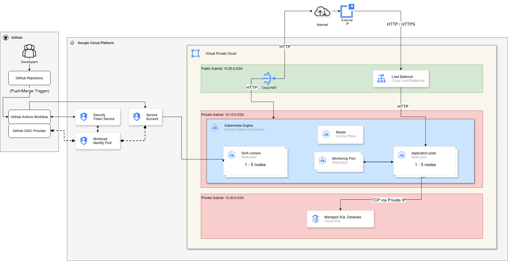
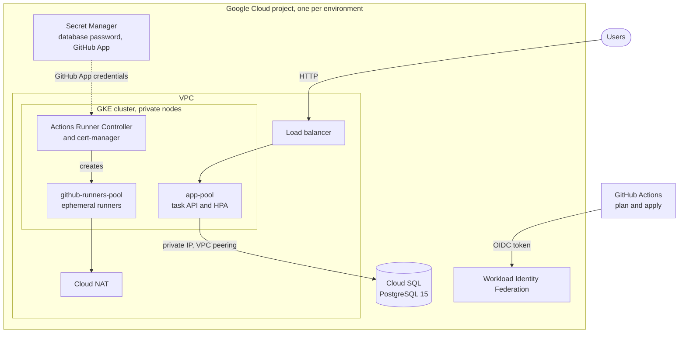
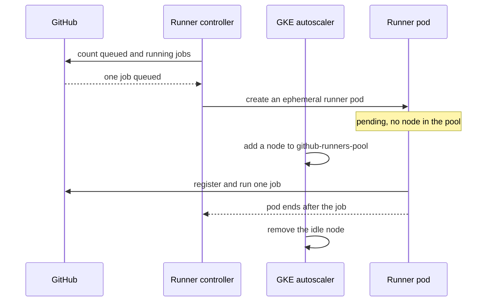

# Infrastructure as Code: a GKE platform on Google Cloud

A Google Cloud platform described in **Terraform** and **Helm**: a private GKE cluster, a private Cloud SQL database, and **self-hosted GitHub Actions runners** that scale with the job queue on their own node pool. It hosts a small NestJS task API, used as the workload to deploy.

<p align="center">
  
  <br><em>Design diagram of the platform. The monitoring pool was designed but is not part of this code, and the CIDRs are indicative.</em>
</p>


## Features

- **Network**: VPC with public and private subnets, firewall rules, and Cloud NAT so that private nodes can reach the Internet
- **GKE**: regional cluster with private nodes, network policy enforcement, shielded nodes, and two autoscaled node pools
- **Runners**: Actions Runner Controller, ephemeral runners, a tainted node pool that can scale down to zero
- **Database**: Cloud SQL for PostgreSQL 15, private IP only, regional availability, backups and point-in-time recovery
- **Identity**: GitHub Actions authenticates to Google Cloud with OIDC (Workload Identity Federation), without a service account key
- **Permissions as code**: two separate stacks for Google Cloud and GitHub access
- **Two environments**, `dev` and `prd`, each with its own variables and Terraform state

## Architecture



The runners are the part with the most moving pieces. The controller polls GitHub, adds runner pods when jobs are waiting, and the node pool grows only when those pods need a node:



```
terraform/
  main.tf               root module: wires every module together
  modules/              network, gke, iam, cloudsql, storage, secrets,
                        cert-manager, github-runners
  charts/               Helm charts: iac (the API) and github-runners
  environments/         dev and prd variable and backend templates
  stacks/               iam-gcp and iam-github, applied separately
application/            NestJS task API, Dockerfile and docker-compose.yml
.github/workflows/      plan, apply and destroy
docs/                   architecture notes and runbooks
deploy.sh, destroy.sh   command-line wrappers around Terraform
```

## Environments

Sizes come from the `terraform.tfvars.example` templates.

| | dev | prd |
|---|---|---|
| App node pool, per zone | 1 to 2 `e2-standard-4` | 2 to 4 `e2-standard-4` |
| Runner node pool, per zone | 0 to 2 `e2-standard-2` | 0 to 3 `e2-standard-4` |
| Runners | 0 to 2 | 0 to 3 |
| API replicas (HPA, 70% CPU) | 1 to 2 | 2 to 5 |
| Cloud SQL tier | `db-f1-micro` | `db-g1-small` |

## Run the API locally

Requires Docker with Compose. Nothing is created on Google Cloud.

```bash
cd application
docker compose up --build
curl http://localhost:3000/api/v1/health
```

Then, in another terminal, play the main scenario against it: `bash test-api.sh`.

| Method | Route, under `/api/v1` | Action |
|---|---|---|
| GET | `/health` | Health check |
| POST | `/auth/register`, `/auth/login` | Get a JWT |
| GET, POST | `/tasks` | List or create your tasks |
| GET, PUT, DELETE | `/tasks/:id` | Read, update or delete one task |

Each write carries a `request_timestamp`. An update or a delete that is not newer than the last one applied is rejected with a 409, so that late requests do not overwrite newer data.

## Deploy

Requires Terraform 1.6 or later, `gcloud`, a Google Cloud project with billing, and a GitHub App for the runners. This creates paid resources.

1. Copy each `*.tfvars.example` to the same name without `.example`, and fill it in. The real files are ignored by Git.
2. Store the GitHub App ID, installation ID and private key in Secret Manager, under the names set in `terraform.tfvars`. See [SECURITY.md](SECURITY.md).
3. Apply:

```bash
cd terraform
terraform init -backend-config=environments/dev/backend.tfvars
terraform plan -var-file=environments/dev/terraform.tfvars -out=dev.tfplan
terraform apply dev.tfplan
```

## Project status

This is a school project, kept as it was delivered. No live environment is provided, and the code has these known limits:

- `terraform/variables.tf` has a corrupted `region` variable, so `terraform init` fails
- the workflows target the original projects, the production identity is still `to_set`, and the `.tfvars` files they read are no longer in the repository
- Workload Identity for the API pods is not enabled; the service account exists, but its binding is commented out
- the API chart passes the database password as a plain environment variable and does not set `JWT_SECRET`
- traffic to the API is plain HTTP; the HTTPS load balancer of the `network` module is optional and off
- the `request_timestamp` check is not atomic: two simultaneous updates can both be accepted
- the API has one unit test, and its generated end-to-end test no longer matches the routes

## Documentation

- [docs/architecture.md](docs/architecture.md): architecture notes
- [docs/runbooks/](docs/runbooks): deployment and troubleshooting
- [terraform/README.md](terraform/README.md): Terraform configuration
- [DEPLOYMENT.md](DEPLOYMENT.md): scripts and workflows (in French)

Some of these documents describe earlier stages of the project.

## Team

Team project of 4 at Epitech (September to November 2025):

- [Yann Lebib](https://github.com/LebibYann): network, GKE, runners, Terraform modules, task API, IAM stacks
- [Lenny Vigeon](https://github.com/Linnchoeuh): repository setup, first Terraform resources, CI fixes and OIDC authentication
- [Rémy, "Florent"](https://github.com/FlorentWasTaken): first Terraform base, Kubernetes manifests, scaling and alerting experiments
- Célian Friedrich: Cloud SQL and application infrastructure in Terraform

## My contribution

The commit history is kept in this repository, with some branches squashed on merge. My part, from the commits:

- **Network**: public and private subnets, firewall rules, Cloud Router and Cloud NAT
- **GKE**: cluster, service account and IAM roles, autoscaled node pools
- **Terraform layout**: reorganisation of the project into modules and environments
- **Runners**: Actions Runner Controller, dedicated node pool and the `github-runners` chart; Helm chart of the API
- **CI/CD**: first Terraform workflows, then the plan, apply and destroy workflows per environment
- **Permissions as code**: the Google Cloud and GitHub IAM stacks
- **Application**: the NestJS task API and its Docker setup
- **Documentation**: architecture diagram, deployment scripts and guides, configuration templates
